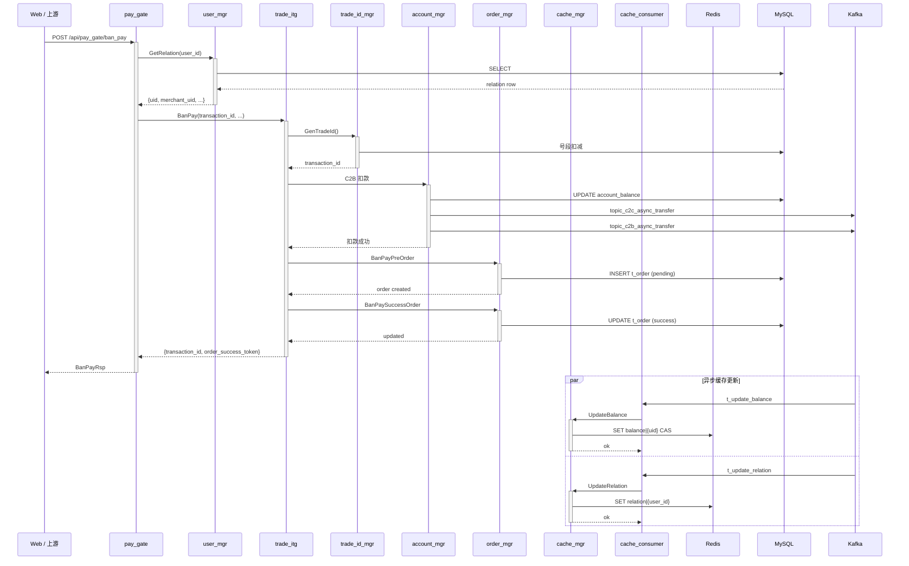

# StarSlipay 整体架构

## 1. 技术栈

| 类别 | 技术 | 版本 |
|---|---|---|
| 语言 | Go | 1.25 |
| RPC 框架 | go-zero | v1.10.2 |
| 前端 | Vue 3 + Vite + Tailwind | - |
| 服务注册/发现 | etcd | 3.x |
| 数据库 | MySQL | 8.0（主从半同步） |
| 缓存 | Redis | 7.x（1主2从 + 3哨兵） |
| 消息队列 | Apache Kafka | 3.x（3节点 KRaft） |
| 监控 | Prometheus + Grafana | - |
| 日志 | Loki + Promtail | - |
| 链路追踪 | Tempo（OTLP HTTP） | - |
| 容器化 | Docker / K8s | - |

## 2. 总体架构（分层）

```mermaid
graph TB
    subgraph 前端层
        Web[Web 管理端<br/>Vue 3 + Axios]
    end

    subgraph 网关层
        PayGate[pay_gate<br/>HTTP REST 网关<br/>go-zero rest]
    end

    subgraph 业务服务层 [go-zero zrpc]
        UserMgr[user_mgr<br/>用户管理]
        AccountMgr[account_mgr<br/>账户/账本]
        OrderMgr[order_mgr<br/>订单管理]
        TradeItg[trade_itg<br/>交易集成]
        TradeIdMgr[trade_id_mgr<br/>号段生成]
        CacheMgr[cache_mgr<br/>缓存管理]
    end

    subgraph 消息驱动模块
        CacheConsumer[cache_consumer<br/>消费 t_update_balance<br/>消费 t_update_relation]
        AsyncAccConsumer[async_account_consumer<br/>消费 c2c/c2b 异步转账]
    end

    subgraph 定时任务模块
        AsyncAccCheck[async_account_check<br/>异步账务对账]
        CacheCheck[cache_check<br/>缓存一致性校验]
        OrderCheck[order_check<br/>订单对账]
    end

    subgraph 中间件层
        MySQL[(MySQL 主从半同步<br/>mysql-master / slave1 / slave2)]
        Redis[(Redis 1主2从<br/>+ 3哨兵)]
        Kafka[Kafka 3节点 KRaft<br/>kafka1 / kafka2 / kafka3]
        Etcd[etcd 3节点<br/>服务注册发现]
    end

    subgraph 可观测性
        Prometheus[Prometheus 指标采集]
        Grafana[Grafana 看板]
        Loki[Loki 日志]
        Tempo[Tempo 链路追踪]
        Promtail[Promtail 日志采集<br/>docker_sd 自动发现]
    end

    %% 前端调用网关
    Web -->|HTTPS| PayGate

    %% PayGate 的 zrpc 依赖
    PayGate -->|zrpc| UserMgr
    PayGate -->|zrpc| AccountMgr
    PayGate -->|zrpc| OrderMgr
    PayGate -->|zrpc| TradeItg
    PayGate -->|Redis Get| Redis

    %% TradeItg 依赖其他 RPC
    TradeItg -->|zrpc| UserMgr
    TradeItg -->|zrpc| AccountMgr
    TradeItg -->|zrpc| OrderMgr
    TradeItg -->|zrpc| TradeIdMgr

    %% UserMgr / AccountMgr 自己的依赖
    UserMgr -->|读/写| MySQL
    UserMgr -->|生产者| Kafka
    AccountMgr -->|读/写| MySQL
    OrderMgr -->|读/写| MySQL
    TradeIdMgr -->|读/写| MySQL
    CacheMgr -->|读/写| Redis

    %% 消息驱动模块
    UserMgr -.->|t_update_relation| Kafka
    AccountMgr -.->|t_update_balance| Kafka
    AccountMgr -.->|topic_c2c_async_transfer| Kafka
    AccountMgr -.->|topic_c2b_async_transfer| Kafka
    CacheConsumer -->|消费| Kafka
    CacheConsumer -->|zrpc| CacheMgr
    AsyncAccConsumer -->|消费| Kafka
    AsyncAccConsumer -->|zrpc| AccountMgr

    %% 定时任务
    AsyncAccCheck --> MySQL
    AsyncAccCheck --> AccountMgr
    CacheCheck --> Redis
    CacheCheck --> MySQL
    OrderCheck --> OrderMgr
    OrderCheck --> MySQL

    %% 服务注册
    UserMgr -.->|注册| Etcd
    AccountMgr -.->|注册| Etcd
    OrderMgr -.->|注册| Etcd
    TradeItg -.->|注册| Etcd
    TradeIdMgr -.->|注册| Etcd
    CacheMgr -.->|注册| Etcd
    PayGate -.->|注册| Etcd

    %% 监控指标
    PayGate -.->|/metrics| Prometheus
    UserMgr -.->|/metrics| Prometheus
    AccountMgr -.->|/metrics| Prometheus
    OrderMgr -.->|/metrics| Prometheus
    TradeItg -.->|/metrics| Prometheus
    TradeIdMgr -.->|/metrics| Prometheus
    CacheMgr -.->|/metrics| Prometheus

    %% 日志
    PayGate -.->|stdout| Promtail
    UserMgr -.->|stdout| Promtail
    AccountMgr -.->|stdout| Promtail
    OrderMgr -.->|stdout| Promtail
    TradeItg -.->|stdout| Promtail
    TradeIdMgr -.->|stdout| Promtail
    CacheMgr -.->|stdout| Promtail
    Promtail --> Loki

    %% Trace
    PayGate -.->|OTLP HTTP| Tempo
    UserMgr -.->|OTLP HTTP| Tempo
    AccountMgr -.->|OTLP HTTP| Tempo
    OrderMgr -.->|OTLP HTTP| Tempo
    TradeItg -.->|OTLP HTTP| Tempo
    TradeIdMgr -.->|OTLP HTTP| Tempo
    CacheMgr -.->|OTLP HTTP| Tempo

    %% Grafana 数据源
    Prometheus --> Grafana
    Loki --> Grafana
    Tempo --> Grafana
```

## 3. 核心支付链路（BanPay）时序

## 4. 模块职责与对外接口

### 4.1 pay_gate — HTTP 网关（go-zero rest）

- **定位**：唯一对外 HTTP 入口，鉴权、限流、路由分发到各 zrpc 服务
- **middleware**：
  - `AuthInterceptorMiddleware`：从 header 取 UserToken / BusinessInfo / UserId
  - `RateLimitMiddleware`：Redis 令牌桶限流
  - `MetricMiddleware`：Prometheus 指标埋点
  - `AccessLogMiddleware`：ACCESS-IN / ACCESS-OUT 两条日志
- **zrpc 依赖**：UserMgr、AccountMgr、TradeItg、OrderMgr
- **Redis**：balance / relation 缓存（哨兵 failover）+ 自定义 TraceHook

| 路由 | 方法 | 说明 |
|---|---|---|
| POST /ban_pay | BanPay | C2B 支付 |
| POST /pay_pre | PayPre | 支付预交易 |
| POST /close_or_supply_order | CloseOrSupplyOrder | 关单或补单 |
| POST /supply_order | SupplyOrder | 仅补单 |
| POST /close_order | CloseOrder | 仅关单 |
| POST /c2c_transfer_pre / do | C2cTransferPre/Do | C2C 转账 |
| POST /c2bank_pre / do | C2BankPre/Do | C2 提现到银行 |
| POST /bank2c_pre / do | Bank2CPre/Do | 银行充值到 C |
| POST /reg_user | RegUser | 注册用户 |
| POST /update_user_info | UpdateUserInfo | 更新用户信息 |
| POST /cancel_user | CancelUser | 注销用户（软删除） |
| POST /get_user_info | GetUserInfo | 获取用户信息 |
| POST /get_user_token | GetUserToken | 获取用户 token |
| POST /get_user_balance_info | GetUserBalanceInfo | 查余额（Redis 优先） |
| POST /get_user_flow | GetUserFlow | 查资金流水 |
| POST /get_c2c_bill | GetC2CBill | 查 C2C 单据 |
| POST /query_order | QueryOrder | 查订单（返回 order_mgr 全部字段） |
| POST /query_c2b_bill | QueryC2BBill | 查 C2B 单据（返回 account_mgr 全部字段） |
| GET /health | Health | 健康检查 |

### 4.2 user_mgr — 用户管理（go-zero zrpc）

- **proto RPC**：
  - `RegUser` / `CancelUser` / `CheckUserToken` / `GetUserToken`
  - `GetUserInfo` / `UpdateUserInfo` / `CheckPassword`
  - `GetRelation` / `GetMerchantInfo`
- **MySQL 表**：`t_user_info`、`t_relation`
- **Kafka 生产者**：`t_update_relation`（relation 变更后通知 cache_mgr）
- **Redis 缓存**：`relation|{user_id}` 由 cache_mgr 写入，go-zero 裸 redis 需建 trace hook

### 4.3 account_mgr — 账户/账本（go-zero zrpc）

- **proto RPC**：
  - `CreateAccount`
  - `Bank2C` / `C2Bank` / `C2cTransferLocal` / `C2cTransferStrong`
  - `C2CFinal` / `C2BFinal`（最终入账）
  - `CloseC2BBill`
  - `GetUserBalanceInfo` / `GetUserFlow` / `GetC2CBill` / `QueryC2BBill`
- **MySQL 表**：`tc_account`、`tc_account_log`、`tc2c_bill`、`tc2b_bill`、`tc2c_pending_transfer`、`tc2b_pending_transfer`、`t_save_bill`
- **Kafka 生产者**：
  - `t_update_balance`（余额变更 → cache_mgr 刷新 Redis）
  - `topic_c2c_async_transfer` / `topic_c2b_async_transfer`（异步扣款/入账）

### 4.4 order_mgr — 订单管理（go-zero zrpc）

- **proto RPC**：
  - `BanPayPreOrder` / `BanPaySuccessOrder`
  - `CloseOrder` / `QueryOrder`
- **MySQL 表**：`t_order`（订单状态机）

### 4.5 trade_itg — 交易集成（go-zero zrpc）

- **proto RPC**：
  - `PayPre` / `BanPay` / `CloseOrSupplyOrder` / `SupplyOrder` / `CloseOrder`
  - `C2cTransferPre/Do` / `C2BankPre/Do` / `Bank2CPre/Do`
- **zrpc 依赖**：UserMgr / AccountMgr / OrderMgr / TradeIdMgr
- **Mock 断点**：`BanPayReq.mock_flag`（0=正常，1=下单前，2=C2B扣款前，3=订单更新前，4=订单更新后），用于故障注入测试

### 4.6 trade_id_mgr — 号段生成（go-zero zrpc）

- **proto RPC**：`GenTradeId` / `GenUid`
- **MySQL 表**：`t_id_segment`（号段扣减）

### 4.7 cache_mgr — 缓存管理（go-zero zrpc）

- **proto RPC**：`UpdateBalance` / `UpdateRelation` / `DeleteRelation`
- **Redis**：`balance|{uid}` / `relation|{user_id}`（URL 键值对格式）
- **CAS 乐观锁**：Lua 脚本 + 版本号，并发冲突自动重试最多 3 次

### 4.8 cache_consumer — Kafka 消费（独立进程）

- 消费 `t_update_balance` / `t_update_relation`
- 转发到 cache_mgr 写 Redis

### 4.9 async_account_consumer — Kafka 消费（独立进程）

- 消费 `topic_c2c_async_transfer` / `topic_c2b_async_transfer`
- 调用 account_mgr 的异步入账

### 4.10 定时任务模块

| 模块 | 运行粒度 | 作用 |
|---|---|---|
| async_account_check | 分钟/小时/天 | 异步账务对账，比对 pending_transfer 与 account_log |
| cache_check | 分钟/小时/天 | 缓存一致性校验，Redis vs MySQL |
| order_check | 分钟/小时/天 | 订单对账，比对 C2B 单据与订单 |

## 5. 中间件部署

| 组件 | 部署形态 | 说明 |
|---|---|---|
| etcd | 3 节点容器 | etcd / etcd2 / etcd3 |
| MySQL | 主从 1+2 | semi_sync 永不降级 |
| Redis | 1主2从 + 3哨兵 | redis-master / redis-slave1/2 / sentinel1/2/3 |
| Kafka | 3 节点 KRaft | kafka1 / kafka2 / kafka3 |
| Prometheus | 单容器 | 抓取各服务 /metrics |
| Grafana | 单容器 | provisioning 自动加载看板 |
| Loki | 单容器 | 本地存储 |
| Promtail | 单容器 | docker_sd 自动发现所有容器 |
| Tempo | 单容器 | OTLP HTTP 4318，本地存储，48h 保留 |

## 6. 缓存策略

- **缓存键**：
  - `relation|{user_id}` → URL 键值对，含 `uid`
  - `balance|{uid}` → URL 键值对，含 `balance`, `balance_modify_time_s`, `balance_modify_time_ms`, `cur_type`
- **读路径**：Redis 优先 → 未命中/不可用/解析失败 → 降级查 DB → 自动回填 Redis
- **写路径**：DB 成功后写 Kafka → cache_consumer → cache_mgr → Redis CAS
- **降级开关**：`Cache.Degrade: true` 时 pay_gate 跳过 Redis 读写强制查 DB（仅排查用，不影响令牌桶限流）

## 7. 可观测性

- **指标**：各 go-zero zrpc 服务自带 `rpc_server_requests_code_total` / `rpc_server_requests_duration_seconds_bucket` 等；业务侧补充自定义埋点；Prometheus 抓取 port 9090，path /metrics
- **日志**：promtail docker_sd 自动采集，标签含 `container` / `compose_service`，Loki 按 `{container="xxx"}` 过滤
- **链路**：各服务 Telemetry 配置 `Batcher: otlphttp Endpoint: tempo:4318 Sampler: 1.0`，裸 go-redis 需自定义 trace hook 才能进入 Tempo

## 8. 错误码规范

- paycomm/xerror 定义公共错误码，各服务复用或扩展
- xerror.HandleRPCError 统一处理 zrpc 返回的 error，区分业务错误（附 code/msg）与网络/超时（500）
